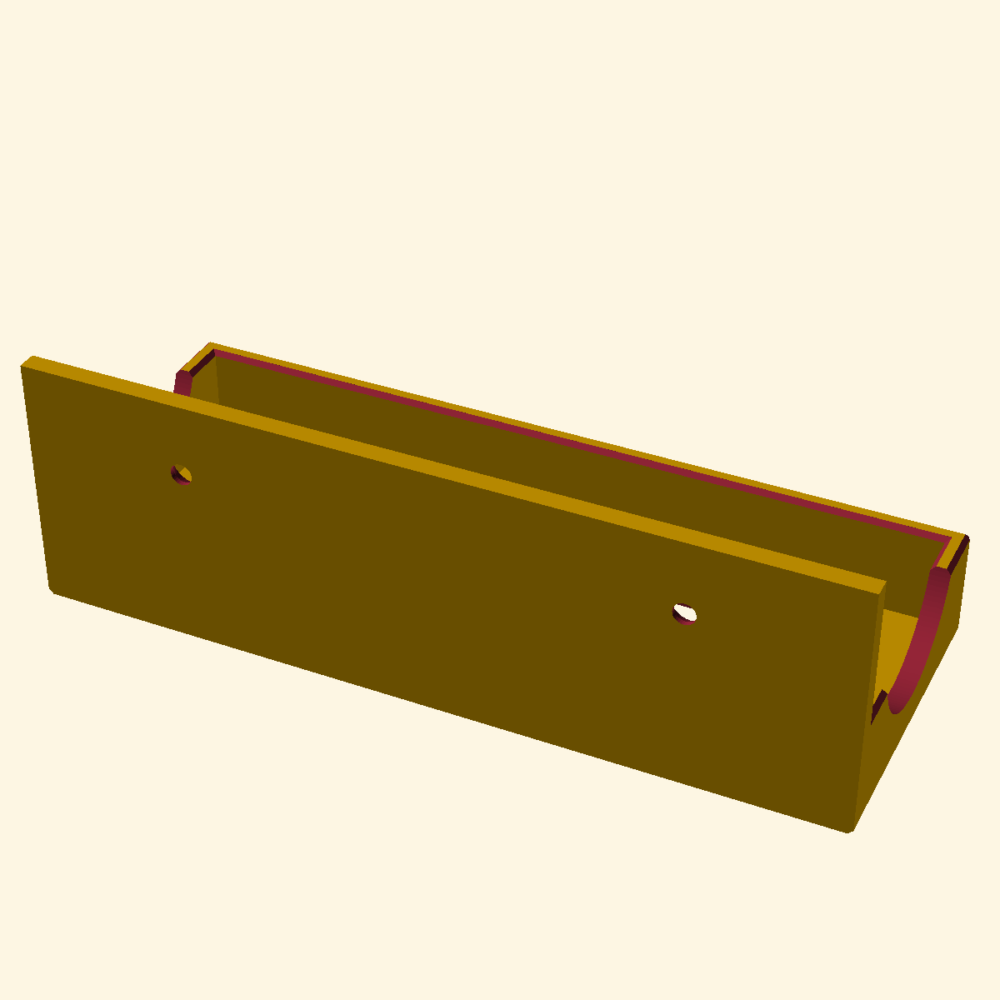

# EasyDrive Battery Charger Wall Mount

A professional, fully parametric, high-performance wall mount for the **EasyDrive Battery Charger** designed in OpenSCAD.

This holder holds the charger in a horizontal orientation, providing a sleek, low-profile, and sturdy mount. It features mitered entry and outer chamfers (phases) for high-quality aesthetics and ergonomics, custom side circular recessions to prevent blocking cooling vents, hidden countersunk mounting screw holes, and a generous bottom ventilation opening.

---

## Features

- **Outward-Only Chamfers (1.0mm Phases):** Features beautiful $45^\circ$ bevels on all visible outer edges and corners (including the exposed top-front and side-front edges of the back wall rising above the pocket height), with smooth spherical transition blends at the corner joints where the back wall and side walls meet to ensure comfortable handling. Keeps the wall-facing back surface 100% flat and sharp so the mount sits perfectly flush and stable against your wall.
- **Top Corner Backplate Chamfers:** The top-left and top-right corners of the backplate are beveled with a beautiful $45^\circ$ cut matching the `chamfer_size` (1.0mm) of the rest of the holder, removing the sharp rectangular profile and unifying the overall aesthetic.
- **Mitered Pocket-Entry Chamfers:** Uses a 3D pyramid frustum hull to cut seamless, mitered inside bevels at the top of the left, front, and right walls. This acts as a funnel/lead-in guide, making the charger incredibly easy to align and slide in, while leaving the back face flat. All chamfer sizes (outer and inner pocket-entry) are perfectly unified under the single `chamfer_size` parameter (1.0mm by default) for a clean, consistent, and symmetrical look.
- **Cooling Ventilation Recessions:** Features deep circular cutouts on both side walls (radius set to 20mm), which keep the charger's fan and exhaust vents fully unblocked, while preserving robust front and back corner "horns" to prevent the charger from tipping forward. Both the outer and inner edges of these circular recesses are beautifully beveled with a $45^\circ$ chamfer (1.0mm) for exceptionally smooth tactile handling, high-end styling, and effortless charger insertion.
- **Bottom Ventilation Cutout:** Includes a large rectangular cutout in the bottom plate to save material, reduce printing time, and allow extra airflow to reach any vents on the bottom of the charger. Both the outer (bottom face) and inner (pocket face) edges of this opening are fully chamfered with $45^\circ$ bevels (1.0mm) to ensure there are no sharp edges on the base opening.
- **Optional Status LED Hole:** Features an optional circular cutout (default 6.0mm diameter) in the front wall, perfectly aligned with the charger's status LED (24.0mm from the right side, 14.0mm from the bottom), so you can monitor the charging state at a glance. Includes a built-in customizable outer flare/countersink (default $45^\circ$, 10.0mm outer diameter) to ensure the LED is highly visible even when viewed from wide angles.
- **Hidden Countersunk Screw Holes:** Features two symmetrically spaced countersunk screw holes designed for 4mm wood or drywall screws (at an absolute center-to-center spacing of **100mm**). Once mounted, the charger covers the screws entirely, resulting in an exceptionally clean, screw-free look.
- **Parametric Mockup Preview:** Includes a translucent grey preview block of the charger in OpenSCAD so you can visualize clearances and fits in real-time. It is automatically ignored during final STL rendering and exports.

---

## Default Dimensions (Optimized for EasyDrive)

- **Charger Width:** 157 mm
- **Charger Depth:** 55 mm
- **Charger Height:** 76 mm
- **Pocket Depth (Charger Seat):** 20 mm
- **Wall Mounting Hole Spacing:** 100 mm (Center-to-center)
- **Chamfer (Phase) Size:** 1.0 mm
- **Side Recession Radius:** 20 mm
- **Wall Thickness:** 4.0 mm
- **Bottom Thickness:** 3.0 mm
- **Clearance Tolerance:** 1.0 mm (added all-around for a smooth slip-fit)
- **Status LED Hole Diameter:** 6.0 mm (fully customizable)
- **Status LED Position:** 24.0 mm from right (133.0 mm from left), 14.0 mm from bottom of the charger
- **Status LED Outer Flare Diameter:** 10.0 mm (creates a clean $45^\circ$ bevel)
- **Status LED Outer Flare Depth:** 2.0 mm (halfway through the wall thickness)

---

## How to Customize

1. Install and open **[OpenSCAD](https://openscad.org/)**.
2. Open `EasyDrive-Charger-Holder.scad`.
3. Use the **Customizer** panel on the right side of the window (go to `Window -> Customizer` if it is hidden) to adjust any parameters:
   - To make the fit tighter or looser, adjust `clearance`.
   - To accommodate larger or smaller screws, adjust `screw_diameter` and `screw_head_diameter`.
   - To customize the mount for a different charger, simply change `charger_width`, `charger_depth`, and `charger_height`.
4. Click **Render (F6)**, then **Export as STL (F7)**.

---

## 3D Printing Recommendations

- **Orientation:** Print the model upright, sitting flat on its bottom plate.
- **Supports:** **No supports needed!** The side recessions are circular arches and the screw holes feature flat cones, which slice and print cleanly on any standard 3D printer without overhang supports.
- **Perimeters / Walls:** 3 or 4 perimeters are recommended to make the mounting tabs and pocket walls extremely sturdy.
- **Infill:** 15% to 20% infill is plenty (Gyroid or Grid infill patterns work great).
- **Material:** PETG or ABS/ASA is recommended if the charger gets warm during use, though PLA is also perfectly fine for indoor wall mounting in normal environments.

---

## Version History

- **v0.01 - v0.02:** Initial parametric outline. Top-front corners of side walls rounded to match front panel.
- **v0.03 - v0.04:** Unified 3D sphere-and-cylinder corner junctions. Vertical front corners rounded all the way to the bottom.
- **v0.05 - v0.06:** Simplified back to a minimalist rectangular block style. Absolute screw spacing set to 100mm with safety caps.
- **v0.07:** Added 1mm chamfers (phases) to all individual straight edges.
- **v0.08:** Redesigned chamfer cuts to subtract outward-facing chamfers only, resolving intersection grooves.
- **v0.09 - v0.10:** Added entry chamfers to inner edges of pocket and back wall.
- **v0.11 - v0.12:** Reverted back wall inner chamfer to keep the back plate flat. Removed all back wall outer chamfers so the wall-facing surface is 100% flat and flush.
- **v0.13:** Adjusted side wall circular recession default radius from 25mm to 20mm.
- **v0.14 - v0.15:** Fixed outer and inner top-side cutters to start exactly at $Y=0$, preventing them from cutting notches into the backplate.
- **v0.16 - v0.17:** Replaced the separate inner top cutters with a single 3D pyramid frustum `hull()` to create mathematically perfect $45^\circ$ mitered corner joints. Tightened helper sheet thickness to 0.01mm for exact 1.0mm chamfer height.
- **v0.18:** Added an optional, fully customizable status LED hole on the front face of the holder (24mm from the right side, 14mm from the bottom), featuring a 45-degree outer flare/countersink for excellent angular visibility. Also updated the translucent charger mockup to include a mock status LED for real-time preview alignment.
- **v0.19 / v0.20:** Introduced a dedicated `entry_chamfer_size` parameter (default `2.0mm`) for the inner top edges of the pocket. This creates a larger, generous lead-in funnel on the front, left, and right inside walls to make sliding the charger in effortless. Ensured all outward edges/corners not against the wall remain beautifully chamfered while keeping the back wall-facing surface 100% flat and flush for maximum wall stability.
- **v0.21:** Added targeted $45^\circ$ chamfers to the exposed portion of the back wall that rises above the side walls (from `Z = 20mm` to `50mm`). This includes the horizontal top-front edge and left-front/right-front vertical corners facing the charger. This rounds all corners next to the user/charger for safety and tactile comfort, while maintaining a 100% flat and sharp wall contact surface.
- **v0.22 / v0.23:** Added $45^\circ$ chamfers to the top-left and top-right corners of the backplate in the XZ plane, matching the default `chamfer_size` (1.0mm) to unify the overall appearance of all outward-facing chamfers without compromising flat wall-mounting stability.
- **v0.24:** Unified all chamfers (including the inner pocket-entry guide) to use the single `chamfer_size` parameter (1.0mm) for absolute consistency, symmetrical beauty, and ease of use, removing any redundant variables.
- **v0.25 / v0.26:** Added $45^\circ$ outer and inner chamfers (matching `chamfer_size` of 1.0mm) to the circular side ventilation cutouts, completely eliminating any sharp edges around the cooling ports on both sides of the walls and finishing the tactile polishing of the holder.
- **v0.27:** Added $45^\circ$ outer and inner rectangular chamfer frustums (matching `chamfer_size` of 1.0mm) to the bottom ventilation opening, completely beveling all edges of the base cutout.
- **v0.28:** Added spherical transition blends at the left and right corner joints where the horizontal side-wall and vertical back-wall chamfers meet, perfectly dissolving the sharp, uncut triangular "teeth" for a flawless, smooth, and tactile surface finish.
