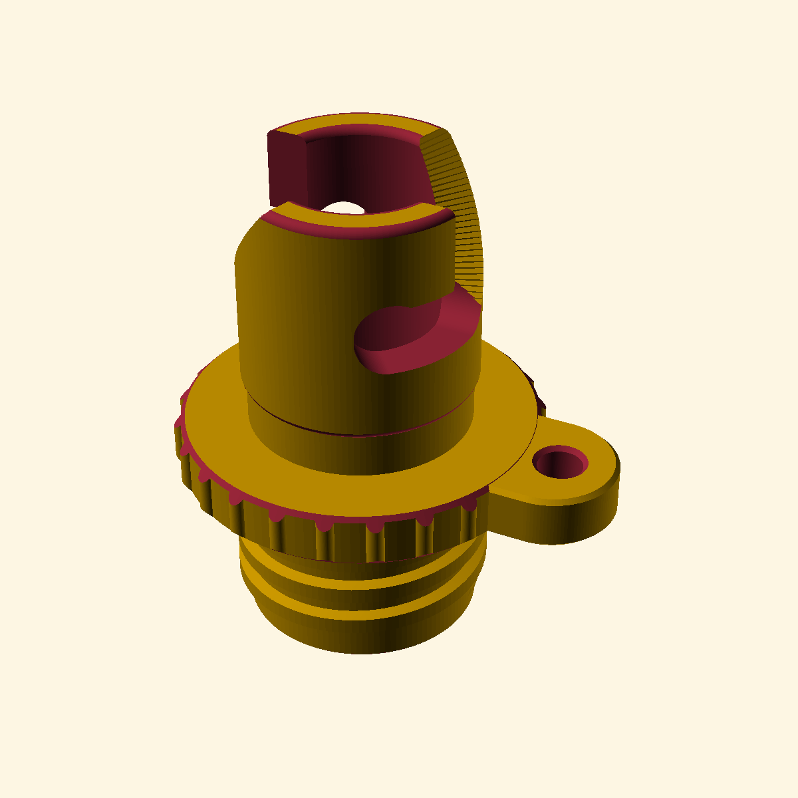
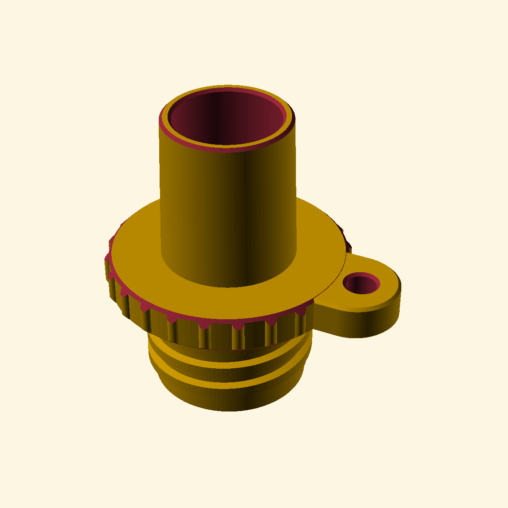
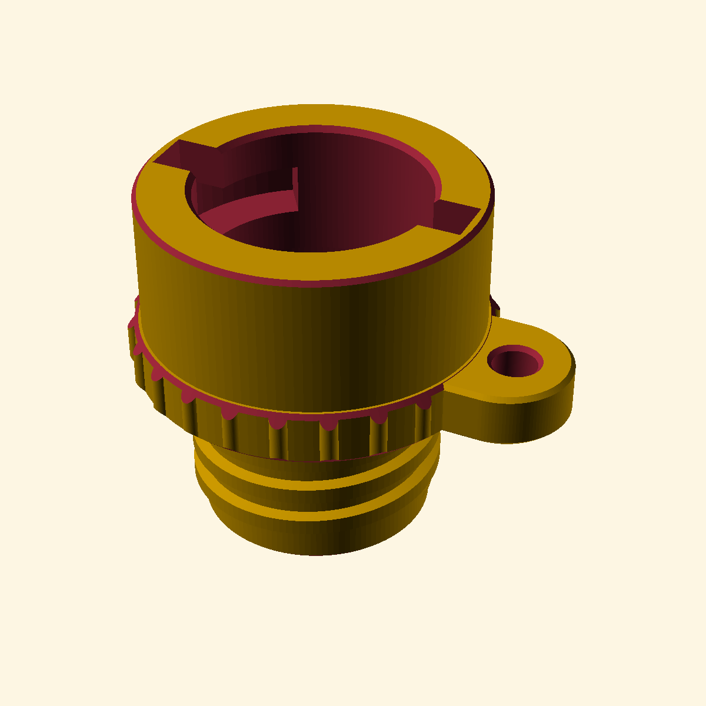
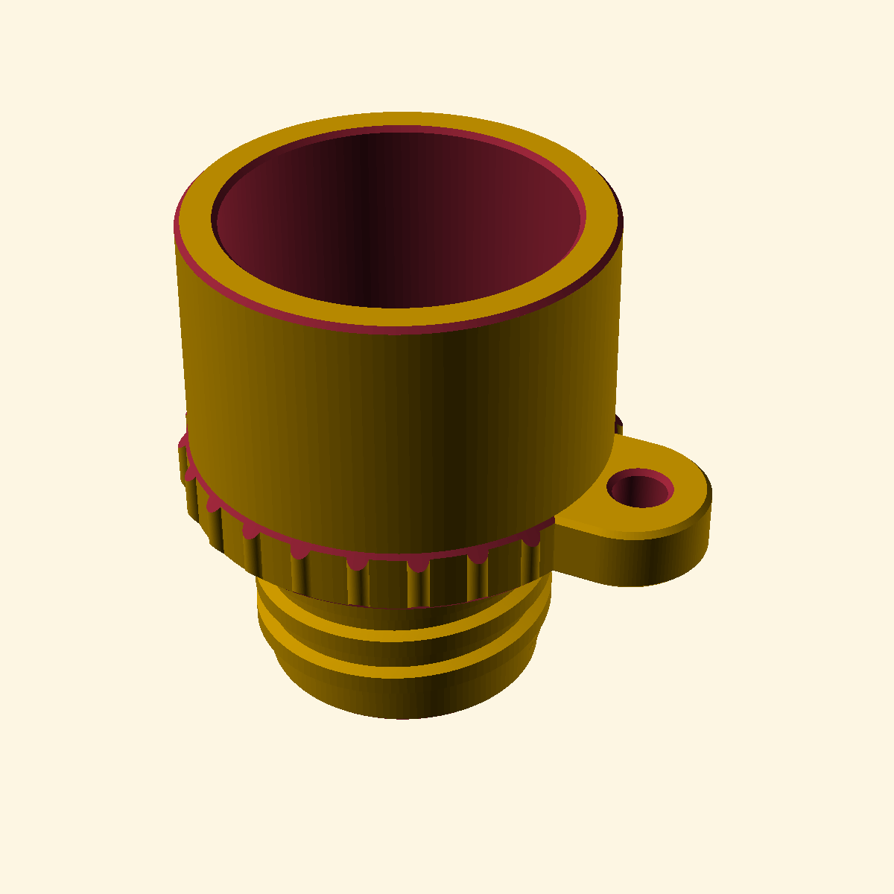
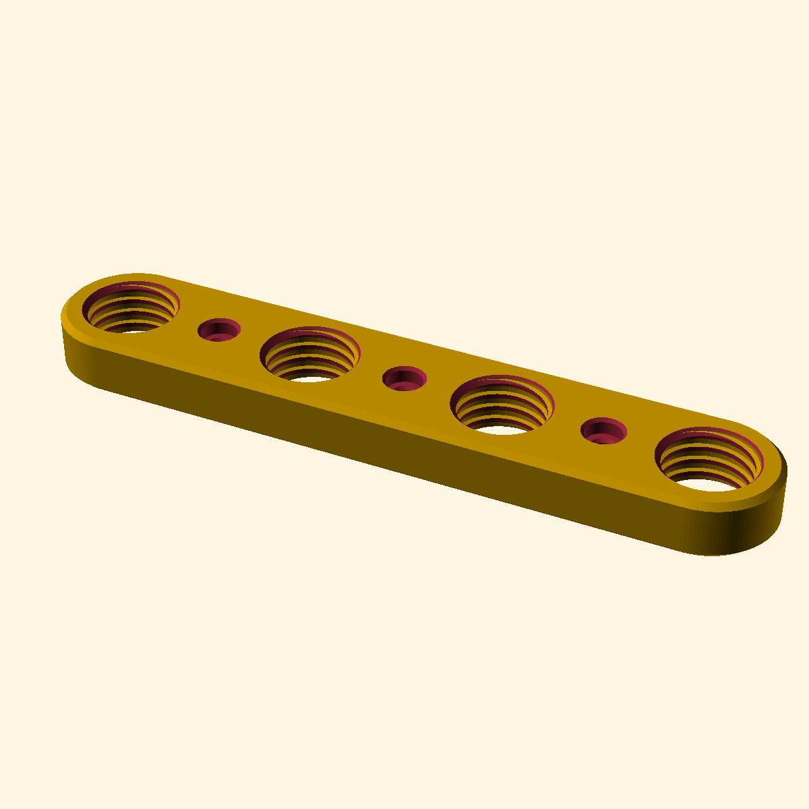

# Pumpressor-Nozzle

**Pumpressor** = kite/wing two-stage pump-compressor.

Parametric [OpenSCAD](https://openscad.org) model of 3D-printable nozzle adapters that connect a
shared threaded air line to inflatable gear.


## Adapters

All adapters share the same threaded end and grip lip, so they all fit the same air line:

The grip lip's vertical ribs are optional (`grip_ribs`), and it can carry 0, 1 or 2 lanyard ears
(`lip_ears_n`), each a 12 mm-wide tab with a 4 mm through hole centered on the rounded ear end.

| Adapter | Valve side |
|---|---|
| `sup` | Female 21 mm SUP pump bayonet (Halkey-Roberts style) with J-slots, lead-in ramps, seal seat neck, rounded bayonet edges and grip lip |
| `boston` | Straight tapered Boston-valve barrel (20 mm long, 17 mm → 18.11 mm OD at a 1:18 taper ratio, chamfered tip; the longer/thicker base also grips worn or out-of-tolerance valve mouths) |
| `kite` | Female 20 mm kite/wing pump bayonet socket, 13 mm deep, with two L-grooves for 4 mm locking pegs (axial entry slots turning into a 40° arc groove); the chamber floor captures a standard 1/2" flat rubber tap-washer seal (~23 × 16 × 2.2 mm) that the pump valve tip presses against |
| `maxflow` | MaxFlow tapered nozzle barrel as used on Ensis wings and Liquid Force kites (18 mm long, 31.5 mm → 31.25 mm OD, constant 3 mm wall → 25.25 mm tip bore, both tip edges lightly chamfered) |

| sup | boston | kite | maxflow |
|:---:|:---:|:---:|:---:|
|  |  |  |  |

## Shared threaded end

- Male ACME thread (29° included flank angle): 21 mm minor / 23 mm major Ø, 15 mm long, 3.5 mm
  pitch, 1 mm ridge height, 2 mm ridge width at the minor diameter
- Matched by the female ACME threads of `Nozzle-Holder.scad`
- 14 mm through bore for the air passage
- 16 mm × 2 mm counterbore at the open (tip) end, ending in a 45° transition into the main bore
- Matching 0.2 mm / 45° chamfers on both edges of the threaded tip (inner counterbore edge and outer lead-in)

Everything is driven by parameters in the OpenSCAD customizer (thread dimensions, bore/counterbore,
bayonet geometry, barrel geometry, kite socket/seal geometry, etc.), and `adapter` selects which
model to render (`"sup"`, `"boston"`, `"kite"`, `"maxflow"` or `"all"` side by side). `section_view = true`
shows a vertical cutaway.

## Nozzle holder

`Nozzle-Holder.scad` is a companion mounting strip with four through-threaded ACME holes (50 mm
spacing) and counterbored mounting holes, for stowing the nozzles on a wall, rack or trolley:



## Files

| File | Description |
|---|---|
| `Pumpressor-Nozzle.scad` | The parametric nozzle model (single file) |
| `Pumpressor-Nozzle.png` | Rendered preview |
| `Pumpressor-Nozzle-sup.png` | Rendered preview of the `sup` adapter |
| `Pumpressor-Nozzle-boston.png` | Rendered preview of the `boston` adapter |
| `Pumpressor-Nozzle-kite.png` | Rendered preview of the `kite` adapter |
| `Pumpressor-Nozzle-maxflow.png` | Rendered preview of the `maxflow` adapter |
| `Pumpressor-Nozzle-Kite.3mf` | Ready-to-print slice of the kite adapter |
| `Nozzle-Holder.scad` | Companion holder strip: 4 through-threaded ACME holes (50 mm spacing) with mounting holes, for stowing the nozzles |
| `Nozzle-Holder.png` | Rendered preview of the holder |

STLs are generated on demand from the `.scad` files (see below), so the printed geometry always
matches the parameters you set.

## Regenerating the output files

```sh
# Nozzle STLs
openscad -D adapter='"sup"'    -o Pumpressor-Nozzle-sup.stl    Pumpressor-Nozzle.scad
openscad -D adapter='"boston"' -o Pumpressor-Nozzle-boston.stl Pumpressor-Nozzle.scad
openscad -D adapter='"kite"'   -o Pumpressor-Nozzle-kite.stl   Pumpressor-Nozzle.scad
openscad -D adapter='"maxflow"' -o Pumpressor-Nozzle-maxflow.stl Pumpressor-Nozzle.scad

# Holder STL
openscad -o Nozzle-Holder.stl Nozzle-Holder.scad

# Previews
openscad -D adapter='"kite"' --render --projection=perspective --autocenter --viewall \
    --imgsize=1200,1200 -o Pumpressor-Nozzle.png Pumpressor-Nozzle.scad
for a in sup boston kite maxflow; do \
    openscad -D adapter="'\"$a\"'" --render --imgsize=1200,1200 --colorscheme=Solarized \
        -o "Pumpressor-Nozzle-$a.png" Pumpressor-Nozzle.scad; done
openscad --render --projection=perspective --autocenter --viewall \
    --imgsize=1200,1200 -o Nozzle-Holder.png Nozzle-Holder.scad
```

## Printing notes

The nozzles print well upright (threaded end down) in PLA or PETG without supports; the holder
strip also prints without supports thanks to the sacrificial membrane over its mounting holes
(poke it out after printing). The threaded tip has only a 0.2 mm lead-in chamfer, so test-fit the
air line connection before field use.
