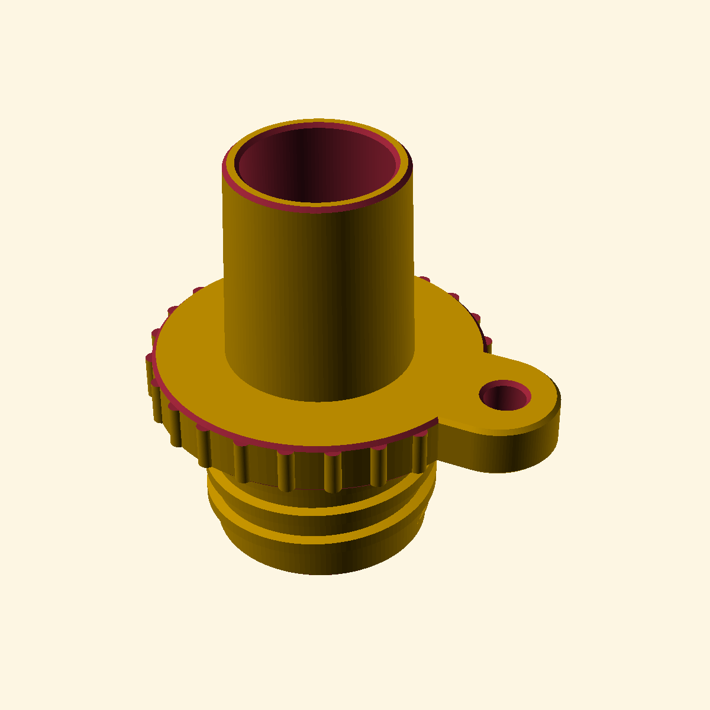

# SUP-Nozzle

Parametric [OpenSCAD](https://openscad.org) model of 3D-printable nozzle adapters that connect a
shared threaded air line to inflatable gear.



## Adapters

All adapters share the same threaded end and grip lip, so they all fit the same air line:

The grip lip's vertical ribs are optional (`grip_ribs`), and it can carry 0, 1 or 2 lanyard ears
(`lip_ears_n`), each a 12 mm-wide tab with a 4 mm through hole centered on the rounded ear end.

| Adapter | Valve side |
|---|---|
| `sup` | Female 21 mm SUP pump bayonet (Halkey-Roberts style) with J-slots, lead-in ramps, seal seat neck, rounded bayonet edges and grip lip |
| `boston` | Straight tapered Boston-valve barrel (20 mm long, 17 mm → 18.11 mm OD at a 1:18 taper ratio, chamfered tip; the longer/thicker base also grips worn or out-of-tolerance valve mouths) |

## Shared threaded end

- M21×3.5 mm thread (21 mm base Ø, 15 mm long, 1 mm-tall ridges, 1.6 mm wide at the surface, 1.9 mm groove)
- 14 mm through bore for the air passage
- 16 mm × 2 mm counterbore at the open (tip) end, ending in a 45° transition into the main bore
- Matching 0.2 mm / 45° chamfers on both edges of the threaded tip (inner counterbore edge and outer lead-in)

Everything is driven by parameters in the OpenSCAD customizer (thread dimensions, bore/counterbore,
bayonet geometry, barrel geometry, etc.), and `adapter` selects which model to render
(`"sup"`, `"boston"` or `"all"` side by side). `section_view = true` shows a vertical cutaway.

## Files

| File | Description |
|---|---|
| `SUP-Nozzle.scad` | The parametric model (single file) |
| `SUP-Nozzle.png` | Rendered preview |

STLs are generated on demand from the `.scad` file (see below), so the printed geometry always
matches the parameters you set.

## Regenerating the output files

```sh
# STLs
openscad -D adapter='"sup"'    -o SUP-Nozzle-sup.stl    SUP-Nozzle.scad
openscad -D adapter='"boston"' -o SUP-Nozzle-boston.stl SUP-Nozzle.scad

# Preview
openscad -D adapter='"boston"' --render --projection=perspective --autocenter --viewall \
    --imgsize=1200,1200 -o SUP-Nozzle.png SUP-Nozzle.scad
```

## Printing notes

The parts print well upright (threaded end down) in PLA or PETG without supports. The threaded
tip has only a 0.2 mm lead-in chamfer, so test-fit the air line connection before field use.
